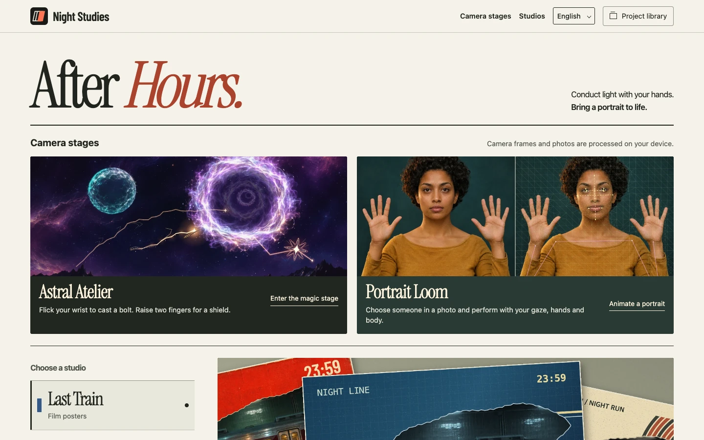

# Night Studies · After Hours

[English](README.md) · [한국어](README.ko.md) · [Deutsch](README.de.md)

[Open Night Studies in English](https://oyoungsoo97-hub.github.io/night-studies/?lang=en)

Two camera stages and three studios for posters, Foley and photography. The language menu switches the interface while you work. Your titles, captions and files keep their original names.

| Stage or studio | Make something |
| --- | --- |
| [Astral Atelier](https://oyoungsoo97-hub.github.io/night-studies/spell-stage/?lang=en) | Pinch to trace starlight, open your palm to cast a nova, and use both hands to open a portal. You can also play with a pointer or touchscreen. |
| [Portrait Loom](https://oyoungsoo97-hub.github.io/night-studies/portrait-stage/?lang=en) | Open a front-facing portrait and inspect its geometric mesh. Calibrate a neutral expression, then use your head, expression and fingers to animate the photograph. A manual pose desk works without a camera. |
| [Last Train](https://oyoungsoo97-hub.github.io/night-studies/last-train/?edition=house&lang=en) | Build a film poster with your photo, an ink treatment, a paper tear and a frame from the train sequence. Export a PNG. |
| [Foley Club](https://oyoungsoo97-hub.github.io/night-studies/foley-club/?edition=house&lang=en) | Score two takes against a film. Adjust cue timing, level and stereo position, then export a 48 kHz stereo WAV. Your own playable MP4 or WebM clip can be up to 60 seconds and 12 MiB. |
| [Light Table](https://oyoungsoo97-hub.github.io/night-studies/light-table/?edition=house&lang=en) | Add up to five photos, arrange three crops and captions, and export your layout as PNG or JPEG. |

### Performing and saving

Use a well-lit frontal photograph for Portrait Loom. Visible fingers allow the source hands to follow your own. Face-only portraits can use illustrated hands. Manual anchors help with faces the detector misses. Both stages export stills and can record up to 12 seconds of the painted stage in browsers with video recording support.

**Save project** keeps your work in this browser’s project library. To move it to another device, choose **Manage → Export file**, then **Import file** in the other browser. A `.nightstudy` file includes the media you imported and the editable settings. Camera access is optional. Frames, imported photos and biometric landmarks are processed on your device. Recording captures the painted stage without microphone audio.

### Run locally

Unzip the distribution and open **Start.command** on macOS, or run `python3 run.py` in the extracted folder with Python 3. On Windows, use `py -3 run.py`. The default address is `http://127.0.0.1:17473/`. Use the same address and browser to return to your saved projects. Press Ctrl+C in the terminal to stop. The tracking models and fonts are included in the ZIP.

[Artwork, models and licenses](CREDITS.md)
